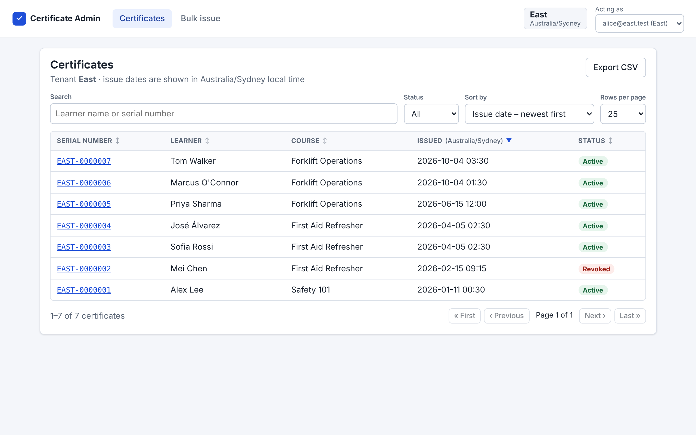
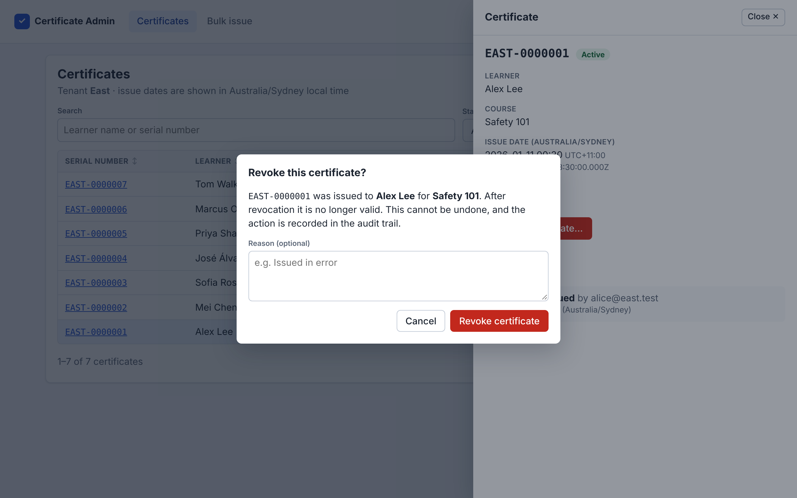
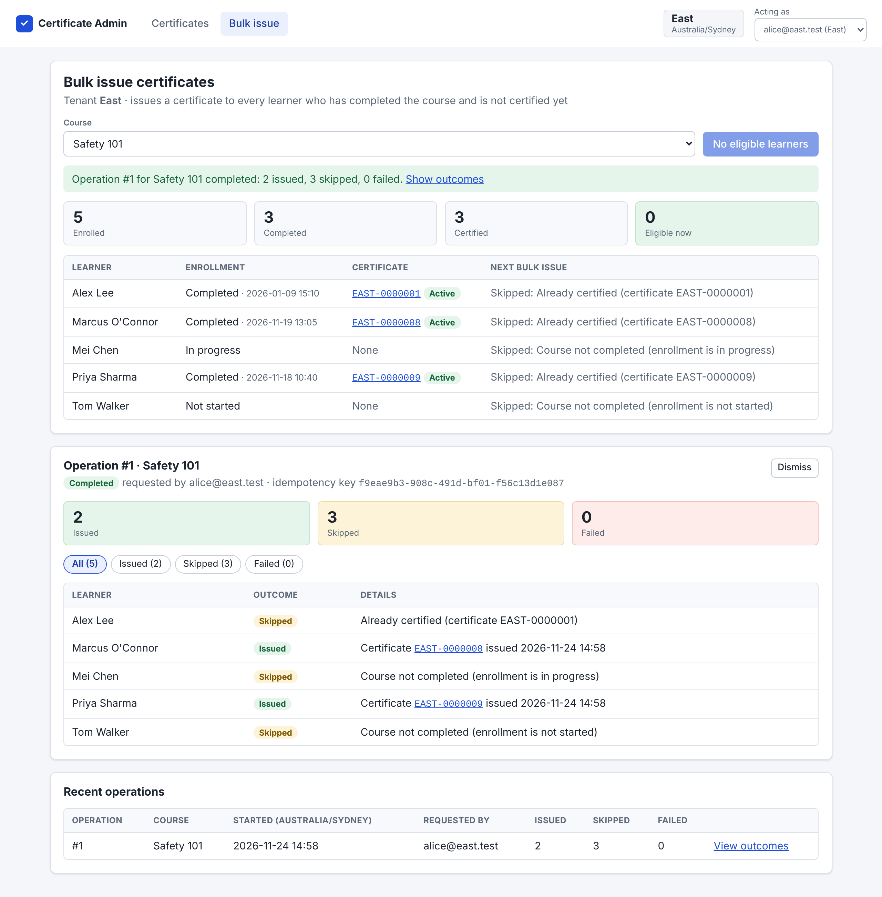

# Certificate Admin Console

Internal admin console for a multi-tenant training platform. Tenant admins review course
completions, bulk-issue certificates, revoke them, and export certificate data as CSV.

| Layer    | Stack                                                                    |
| -------- | ------------------------------------------------------------------------ |
| Backend  | Node.js, Express 5, SQLite (file database in WAL mode, persistent)       |
| Frontend | React 19, Vite                                                           |
| Tests    | `node:test`, black-box over HTTP against the real server process         |

**Requirements:** Node.js 20.19+ or 22.12+ (any newer release works as well) with npm. Nothing
else to install. Verified on Node 20.20, 22.23 and 24.22.



---

## 1. Run it

```bash
npm start
```

That one command installs the declared dependencies, builds the UI, creates the SQLite database
with the demo data (first run only) and starts the whole app on **http://localhost:3000**.

```bash
npm test
```

Runs the verification suite: 105 tests covering acceptance criteria A1–A7, including the
100,000-row export checks. It uses throw-away databases in the OS temp directory and never touches
the app's data. Takes about 30 seconds.

Other commands:

| Command                               | What it does                                                                 |
| ------------------------------------- | ---------------------------------------------------------------------------- |
| `npm run generate:east`               | Adds 100,000 certificates to tenant East (see [section 4](#4-load-test-data-100000-certificates)) |
| `npm run generate:east -- --clear`    | Removes the generated certificates again                                     |
| `npm run db:reset`                    | Restores the pristine quick-start dataset (safe while the server is running) |
| `PORT=4000 npm start`                 | Use another port (more settings below)                                       |
| `npm run dev`                         | Development mode: API with auto-restart + Vite dev server on :5173           |

Data lives in `data/cert-admin.sqlite` and survives restarts.

Settings, all optional, are environment variables. A value that cannot be used is reported in one
line and nothing starts.

| Variable                 | Default                  | Meaning |
| ------------------------ | ------------------------ | ------- |
| `PORT`                   | `3000`                   | HTTP port |
| `HOST`                   | all interfaces           | Address to listen on (`127.0.0.1` = this machine only) |
| `DB_PATH`                | `data/cert-admin.sqlite` | Database file |
| `LOG_REQUESTS`           | on                       | `0` turns the request log off |
| `DB_BUSY_TIMEOUT_MS`     | `10000`                  | How long a write waits for another process's write lock before answering 503 |
| `EXPORT_MAX_CONCURRENT`  | `4`                      | CSV exports that read at the same time; further ones wait their turn |
| `EXPORT_IDLE_TIMEOUT_MS` | `30000`                  | A download whose client accepts no data for this long is dropped (`0` = never) |
| `SQLITE_DRIVER`          | automatic                | `better-sqlite3` or `node` to force one of the two drivers |

The examples in this README are written for a POSIX shell (macOS, Linux, Git Bash or WSL on
Windows). In PowerShell set a variable first, for example `$env:PORT=4000; npm start`; the `npm`
commands themselves are the same everywhere.

## 2. Actors and demo data

There is no login. Every request names its actor in the **`X-Actor-Email`** header; the server looks
the admin up and derives the tenant from that record. The tenant is never read from the URL, the
query string or the body. In the UI, use the **Acting as** switcher in the top-right corner.

| Actor             | Tenant | Time zone          | Serial prefix |
| ----------------- | ------ | ------------------ | ------------- |
| `alice@east.test` | East   | `Australia/Sydney` | `EAST-`       |
| `bob@west.test`   | West   | `Australia/Perth`  | `WEST-`       |

A fresh database always has the same ids:

| Tenant | Courses (id)                                                             | Certificates (ids)   |
| ------ | ------------------------------------------------------------------------ | -------------------- |
| East   | Safety 101 (1), First Aid Refresher (2), Forklift Operations (3)         | 1–7 (id 2 is revoked) |
| West   | Safety 101 (4), Working at Heights (5), Manual Handling (6)              | 8–11 (id 10 is revoked) |

`Safety 101` roster in each tenant (this is the bulk-issue scenario of A4):

| East            | West         | Enrollment  | Certificate                                   | Bulk issue outcome           |
| --------------- | ------------ | ----------- | --------------------------------------------- | ---------------------------- |
| Alex Lee        | Alex Lee     | completed   | issued `2026-01-10T13:30:00Z` (ids 1 and 8)   | skipped: `already_certified` |
| Priya Sharma    | Jordan Smith | completed   | none                                          | **issued**                   |
| Marcus O'Connor | Emily Davis  | completed   | none                                          | **issued**                   |
| Mei Chen        | Noah Wilson  | in progress | none                                          | skipped: `not_completed`     |
| Tom Walker      | Grace Kim    | not started | none                                          | skipped: `not_completed`     |

Alex Lee himself also has a completed-but-uncertified enrollment and an incomplete one in the other
two courses of each tenant, and each tenant has one revoked certificate. East additionally has
certificates issued minutes before and after both 2026 daylight-saving transitions in Sydney.

## 3. Using the console

- **Certificates** – search by learner name or serial number, filter by status, sort by any column
  (header click or the *Sort by* menu), page through results. The search looks for the text
  anywhere in the name or serial number and ignores case and accents (`alvarez` finds
  *José Álvarez*). Loading, empty and error states are shown in place; errors offer *Try again*.
  Click a row for the detail drawer.
- **Detail drawer** – serial number, course, learner, issue date in the tenant's time zone (plus the
  UTC instant), status, and the audit trail. *Revoke certificate…* opens a confirmation dialog with
  an optional reason; nothing is sent until it is confirmed.
- **Export CSV** – downloads exactly the rows of the current search, status filter and sort order.
- **Bulk issue** – choose a course to see its roster and what the next bulk issue will do for each
  learner, then issue. The button locks while the request is in flight, the operation status is
  shown, and the result lists every learner as issued / skipped (with reason) / failed. If the
  answer is lost (network error, 5xx), *Retry safely* repeats the request with the same
  idempotency key. *Recent operations* shows past runs.

| Revoke confirmation | Bulk issue result |
| --- | --- |
|  |  |

## 4. Load-test data (100,000 certificates)

```bash
npm run generate:east                      # takes ~3 s; can run while the server is up
npm run generate:east -- --count 250000    # other volumes
npm run generate:east -- --clear           # remove the generated rows
npm run generate:east -- --db /tmp/load.sqlite   # work on a separate database file instead
                                                 # (start the app on it with DB_PATH=/tmp/load.sqlite npm start)
```

The generator **does not modify the quick-start dataset**. The generated certificates belong to
their own 10 generated courses and 10,000 generated learners (flagged `is_generated = 1`) and are
numbered in a serial range of their own (`EAST-LT-0000001` …). The seeded tenants (their serial
counters included), admins, courses, learners, enrollments, certificates and audit events are left
exactly as they were - asserted row by row in the test suite - so `Safety 101`, `Alex Lee` and
every demo scenario behave as before, and the next certificate issued through the app is
`EAST-0000008` with or without the load-test data. Re-running the generator replaces the previous
generated set, so the count never piles up; `--clear` removes it and leaves exactly the rows that
were there without it; `npm run db:reset` restores the pristine dataset and shrinks the database
file back to its original size.

The generator writes everything in one transaction. While it runs, a server on the same database
keeps answering reads (which see the old rows until the generator commits) and retries of finished
bulk issues; new writes wait for it and complete as soon as it is done.

The data is built to contain many equal sort keys: ~2,500 distinct learner names for 100,000
certificates, 10 course titles, ~150 certificates per calendar day, and batches of 25 certificates
that share the exact same issue instant (like a real bulk issue). It is generated from a seeded
PRNG, so every run produces the same rows, serial numbers included (`--seed N` gives another set).

## 5. HTTP API

All endpoints except `/api/health` and `/api/actors` require `X-Actor-Email`. Errors have the shape
`{"error": {"code": "...", "message": "..."}}`: `400` invalid input, `401` missing or unknown actor,
`404` unknown id (including ids of another tenant), `409` idempotency key reused for a different
request, `413` body larger than 100 kB, and `503` with `Retry-After` in two situations where
nothing was done and the request can simply be repeated: `database_busy` (another process has held
the database's write lock for longer than `DB_BUSY_TIMEOUT_MS`) and `export_busy` (more than 32
exports are already waiting for a free export slot).

Query parameters are validated: an unknown value is a `400`, never silently ignored; a parameter
that is present but blank (`?sort=`) counts as not given.

| Method & path                              | Purpose |
| ------------------------------------------ | ------- |
| `GET /api/actors`                          | Seeded admins for the actor switcher (demo helper) |
| `GET /api/me`                              | The actor and tenant resolved from the header |
| `GET /api/certificates`                    | List. `q` (text contained in the learner name or serial number, case and accents ignored), `status` (`all`\|`active`\|`revoked`), `sort` (`issued`\|`learner`\|`course`\|`serial`\|`status`), `order` (`asc`\|`desc`), `page`, `pageSize` (≤ 100) |
| `GET /api/certificates/export.csv`         | CSV of everything matching the same `q`, `status`, `sort`, `order` |
| `GET /api/certificates/:id`                | Detail incl. `issuedLocal`, `issuedUtcOffset` and `auditEvents` |
| `POST /api/certificates/:id/revoke`        | Revoke. Body `{"reason": "…"}` is optional. Idempotent |
| `GET /api/courses`                         | Courses of the tenant |
| `GET /api/courses/:id/enrollments`         | Roster with per-learner eligibility and course totals |
| `POST /api/bulk-issues`                    | Bulk issue. Body `{"courseId": 1}`, header `Idempotency-Key` |
| `GET /api/bulk-issues`, `GET /api/bulk-issues/:id` | Recent operations / the stored result of one |
| `GET /api/audit-events`                    | Audit trail; filters `certificateId`, `bulkOperationId`, `action` (`certificate.issued`\|`certificate.revoked`) |

Examples (with the default data):

```bash
A='X-Actor-Email: alice@east.test'; B='X-Actor-Email: bob@west.test'; URL=http://localhost:3000

curl -s -H "$A" "$URL/api/certificates?q=alex&sort=issued&order=desc&page=1&pageSize=25"
curl -s -H "$A" "$URL/api/certificates/1"            # issuedLocal "2026-01-11 00:30"
curl -s -H "$B" "$URL/api/certificates/8"            # issuedLocal "2026-01-10 21:30"
curl -s -H "$B" "$URL/api/certificates/1"            # 404: East certificate, West admin

curl -s -X POST -H "$A" -H 'Content-Type: application/json' -H 'Idempotency-Key: demo-1' \
     -d '{"courseId": 1}' "$URL/api/bulk-issues"     # 201, 2 issued / 3 skipped
#  ... run it again: same body, header "Idempotent-Replayed: true", nothing new is written
curl -s -X POST -H "$A" -H 'Content-Type: application/json' -H 'Idempotency-Key: demo-1' \
     -d '{"courseId": 2}' "$URL/api/bulk-issues"     # 409 idempotency_key_reused
curl -s -X POST -H "$B" -H 'Content-Type: application/json' \
     -d '{"courseId": 1}' "$URL/api/bulk-issues"     # 404: East course, West admin

curl -s -X POST -H "$A" "$URL/api/certificates/3/revoke"   # 200, "alreadyRevoked": false
curl -s -X POST -H "$A" "$URL/api/certificates/3/revoke"   # 200, "alreadyRevoked": true, no new audit event

curl -s -H "$A" "$URL/api/certificates/export.csv?q=lee&sort=learner&order=asc"
```

A bulk-issue response:

```json
{
  "id": 1,
  "status": "completed",
  "course": { "id": 1, "title": "Safety 101" },
  "idempotencyKey": "demo-1",
  "requestedBy": "alice@east.test",
  "summary": { "total": 5, "issued": 2, "skipped": 3, "failed": 0 },
  "results": [
    { "learnerId": 1, "learnerName": "Alex Lee", "outcome": "skipped", "reason": "already_certified",
      "message": "Already certified (certificate EAST-0000001)", "certificateId": 1, "serialNumber": "EAST-0000001" },
    { "learnerId": 3, "learnerName": "Marcus O'Connor", "outcome": "issued",
      "certificateId": 12, "serialNumber": "EAST-0000008", "issuedLocal": "2026-11-23 18:33" },
    { "learnerId": 4, "learnerName": "Mei Chen", "outcome": "skipped", "reason": "not_completed",
      "message": "Course not completed (enrollment is in progress)" }
  ]
}
```

Skip reasons: `already_certified`, `not_completed`, `certificate_revoked`. A learner whose
certificate could not be written is reported as `"outcome": "failed"`; nothing is saved for that
learner, the others are unaffected, and the cause goes to the server log (not into the response).

CSV format: UTF-8, one header row, columns `Learner Name, Course Title, Serial Number,
Issue Date (<tenant time zone>)`, dates as `YYYY-MM-DD HH:mm` in the tenant's time zone, RFC 4180
quoting, `\n` line endings. Cells that would be interpreted as spreadsheet formulas are neutralised.

## 6. How the acceptance criteria are met

| # | Mechanism | Verified by (`backend/test`) |
| - | --------- | ---------------------------- |
| **A1** Tenant isolation | The tenant comes only from the actor record. Every query carries `tenant_id = <actor's tenant>`; ids of other tenants behave exactly like ids that do not exist (404, same body). A cross-tenant bulk issue fails validation before anything is written. Idempotency keys are scoped to (tenant, admin), so a key can never replay another tenant's response. On top of that every reference between tenant-owned tables is a composite `(id, tenant_id)` foreign key, so cross-tenant rows cannot even be inserted. | `acceptance.test.js` › *A1 – tenant isolation* (list, detail, bulk issue, export, revoke, operations, audit; a tenant named in the query, body or headers of any endpoint; keys per admin and compared exactly); `unit.test.js` › *database layer* (each of the 13 cross-tenant references is refused by the schema) |
| **A2** Retry safety | A bulk issue is **one** `BEGIN IMMEDIATE` transaction: look up the key → check eligibility → write certificates and audit events → store the response next to the key → commit. SQLite admits one writer at a time, so identical requests are serialised, also across processes; the first executes, all others replay the stored response byte for byte (`Idempotent-Replayed: true`). A key that has already run is answered from a plain read, without queueing for the write lock - and a request that is already queueing checks again whenever it finds the lock taken, so it gets the same answer as soon as an identical request has completed elsewhere. An operation that fails as a whole leaves nothing behind, not even its key. `UNIQUE (tenant_id, course_id, learner_id)` on certificates is the backstop. | *A2* › sequential retries, 25 concurrent requests, racing keys; **two server processes on one database** whose requests (three per server) are forced to overlap by a third connection holding the write lock; queued requests answered while the lock stays taken; *bulk issue with injected failures* › an operation that dies after it has issued certificates |
| **A3** Key misuse | The request (method, route, canonical JSON body) is fingerprinted with SHA-256 and stored with the key. Same key + different fingerprint → `409 idempotency_key_reused`; nothing is written, and the first result stays as it was. A request whose body cannot be parsed at all (malformed, oversized, unsupported encoding) is a different request too and gets the same 409 once its key has been used. | *A3* › different course, changed payload, reordered JSON (still a replay), unreadable bodies, deeply nested JSON, concurrent misuse (also across two servers) |
| **A4** Learner outcomes | One classification function decides per roster row; the roster preview in the UI uses the same function. Each learner is issued inside a savepoint, so one failure becomes a `failed` outcome without undoing the others and without leaving any of that learner's rows behind. | *A4* › outcomes on Safety 101, second run, revoked certificate; *bulk issue with injected failures* › a learner failing before and after their certificate was written |
| **A5** DST & local date | Instants are stored in UTC. Local values are computed with the tenant's IANA zone through ICU (DST included). The tenant-local calendar date is stored with each certificate at issue time (`issued_local_date`) and is the leading sort key; the CSV prints the local wall-clock time. | `unit.test.js` › *time zones*; `acceptance.test.js` › *A5* (reference instant in both tenants, both 2026 DST transitions, UTC-date vs. local-date ordering, every other time shown: revocation, audit trail, roster, operation history) |
| **A6** Export at scale | See [section 7](#7-design-notes). Every ordering ends in `id`, each is backed by an index, and the export streams from a dedicated read-only connection inside a single read snapshot, returning to the event loop after every 500 rows it has looked at - whether they match the filter or not. | `scale.test.js` (100,000 generated rows; timings are printed), including exports whose filter matches almost nothing; `acceptance.test.js` › *export plumbing* |
| **A7** Revocation audit | `UPDATE … WHERE status = 'active'` and the audit insert share one transaction; the audit event is written only if the update changed a row. Repeats and races return 200 with `alreadyRevoked: true` and write nothing. | *A7* › single revoke, repeats, 12 concurrent revokes; *A2 – write lock* › the same revocation sent to two servers at once (three requests each), and a queued revocation overtaken by another process |

Typical numbers from `npm test` on a 4-core container: filtered and sorted exports of 10,000–100,000
rows take 0.2–0.4 s each and are byte-identical across runs; while three full 100,000-row exports
stream concurrently, ~200 list requests are answered with a median of 5 ms and a worst case under
30 ms; an export whose filter matches nothing (it still has to look at all 100,000 rows) lets some
200 list requests through while it runs, the slowest in about 30 ms; with a download deliberately
stalled mid-export, list requests and a bulk issue still complete in milliseconds; and while the
generator rewrites all 100,000 rows underneath the running server (3–5 s), reads and replays keep
being answered in under 30 ms and a bulk issue sent in the middle completes the moment the
generator commits.

## 7. Design notes

**Persistence.** SQLite in WAL mode: readers never block the writer and the writer never blocks
readers. All work of a request happens on one synchronous connection, which makes each write
transaction trivially atomic; cross-process correctness comes from `BEGIN IMMEDIATE` plus database
constraints, not from the single process. The driver is `better-sqlite3`; if its native binary is
unavailable the app automatically uses Node's built-in `node:sqlite` (Node ≥ 22.13). The suite
passes on both.

**Sharing the database with other processes.** The generator, `db:reset` or a second server may
hold SQLite's write lock for a while. A request handler never sleeps inside SQLite waiting for it —
that would freeze every other request of the process. The lock is only *tried*; while it is taken
the request waits asynchronously (reads, replays and already-revoked answers are served as usual),
and after `DB_BUSY_TIMEOUT_MS` (default 10 s) it gives up with `503` and `Retry-After`. While it
waits it keeps looking at what has been committed meanwhile: if an identical bulk issue has
completed on another server, or the certificate has been revoked by someone else, the answer is
known and is given at once, however long the lock stays taken. Several processes may also start on
a brand-new database file at the same moment: the switch to WAL mode is retried, and schema
creation and seeding re-check under the write lock, so exactly one of them does the work.

**Sorting and determinism.**

| `sort`    | ORDER BY                                                    |
| --------- | ----------------------------------------------------------- |
| `issued`  | tenant-local calendar date, then exact instant, then `id`   |
| `learner` | learner name (case and accents ignored), then `id`          |
| `course`  | course title (case and accents ignored), then `id`          |
| `serial`  | serial number, then `id`                                    |
| `status`  | status, then `id`                                           |

`id` breaks every tie, so equal sort values always come back in the same order: pages never
overlap or skip rows and two exports of the same data are identical. List and export share the
same filter/order builder, and each query is pinned to the index that stores its ordering, so a
page costs an index range scan and an export starts streaming immediately instead of sorting first.

**Search and names.** SQLite on its own treats only the 26 ASCII letters case-insensitively: a
search for `álvarez` would miss *Álvarez*, and *Élodie* would sort after *Zoe*. Each certificate
therefore stores, next to the learner name and course title, a folded copy of both
(`learner_name_key`, `course_title_key`: compatibility forms unified, combining accents removed,
lower-cased), computed once when the certificate is issued. Sorting uses the stored key; searching
folds the search text the same way and looks for it inside the key (or inside the serial number).
`%` and `_` in a search are ordinary characters.

**Export without blocking.** The export opens its own read-only connection and wraps the whole
download in one read transaction: the file is a consistent snapshot even if certificates are issued
or revoked meanwhile, and the main connection stays free. SQLite calls are synchronous, so the
export must never do much in one go: it walks the tenant's rows in the requested order and returns
to the event loop after every 500 rows it has *looked at*. The search and status filter are
evaluated per row as a column of that walk rather than in `WHERE` - otherwise "fetch the next
matching row" could mean scanning the rest of the table in a single call when few rows match. A
concurrent request therefore waits for at most one such step (a millisecond or two), whether the
filter matches everything or nothing. Output is written with back-pressure; only the current batch
is ever in memory.

Resources are bounded as well. At most `EXPORT_MAX_CONCURRENT` (4) exports read at the same time,
each on its own connection; further ones wait in arrival order without holding a connection, and
beyond 32 waiting the answer is `503 export_busy`. A client that disconnects releases its snapshot,
connection and slot immediately; one that merely stops reading is disconnected after
`EXPORT_IDLE_TIMEOUT_MS` (30 s), so a stalled download cannot pin a snapshot (and with it the
write-ahead log) for ever.

**Idempotency details.** `Idempotency-Key` is optional for API callers (the UI always sends one).
Keys are 1–200 printable ASCII characters. A request that is rejected before execution (400, 404,
409, 413, 503) stores nothing, so the key is not "burned" by a typo or a busy database. Replays return the original status code
and body even if the data has changed since (for example, one of the issued certificates was
revoked later).

**Decisions worth knowing.**

- *One certificate per learner and course, ever.* A revoked certificate is not silently re-issued by
  the next bulk issue; the learner is skipped with reason `certificate_revoked`.
- *Certificates snapshot the learner name and course title.* A certificate is an issued document
  and should not change when a learner is renamed; it also keeps list, search and export join-free.
- *Audit events are per certificate* (`certificate.issued`, `certificate.revoked`), exactly one per
  issuance and one per effective revocation. A rejected or replayed request writes none.
- *No time-zone maths in the browser.* The API returns ready-to-show local strings, so UI, CSV and
  sort order cannot disagree.

**Deliberately out of scope / next steps.** Real authentication, tenant and course management,
expiring old idempotency records, re-issuing after revocation, recomputing stored local dates if a
tenant ever changed its time zone, keyset pagination and a trigram or full-text index for tenants
far beyond 10⁵ certificates (deep pages and the substring search of a *list* request are linear in
the tenant's row count today and run in one piece: tens of milliseconds at 100,000 rows), and
moving very large bulk issues to a background job.

## 8. Project layout

```
backend/
  src/server.js            entry point (schema + demo data on first run, then HTTP)
  src/app.js               routes, actor context, error mapping
  src/services/            certificates (list/detail/revoke/export), bulkIssue, courses, ledger, actors
  src/db/                  sqlite adapter, schema, demo seed, load-test generator
  src/lib/                 time zones, text folding (search/sort keys), CSV, request fingerprint,
                           parameter parsing, limiter (export slots)
  scripts/                 init-db.js (--reset), generate-certificates.js
  test/                    unit.test.js, acceptance.test.js (A1–A5, A7, failure injection, export
                           plumbing, start-up and maintenance commands), scale.test.js (A6),
                           helpers.js + support/ (test harness)
frontend/
  src/App.jsx              shell, actor switcher, hash routing
  src/components/          CertificatesPage, CertificateDetail (revoke dialog), BulkIssuePage, ui
  src/api.js, hooks.js     API client, data-loading hook
data/                      SQLite database (created on first start, git-ignored)
docs/screenshots/          the images used in this README
```

## 9. Troubleshooting

- **Port 3000 is in use** – the server says so and exits; start it with `PORT=4000 npm start`.
- **Want a clean slate** – `npm run db:reset`. It empties and re-seeds the tables in one
  transaction, so it works while the server runs (the server simply serves the fresh data
  afterwards). If it reports that the database is busy, another process is in the middle of a
  write (for example the generator): nothing was changed, run it again in a moment.
- **"Database schema version … is not supported"** – the database file was created by a different
  version of this app. Stop the server and run `npm run db:reset`, which recreates the file.
- **A request answers `503 database_busy`** – another process held the write lock for more than
  10 seconds. Nothing was written; repeat the request (the UI offers *Retry safely*), or raise
  the limit with `DB_BUSY_TIMEOUT_MS=60000 npm start`.
- **An export answers `503 export_busy`** – four exports are running and 32 more are waiting.
  Try again in a few seconds, or raise `EXPORT_MAX_CONCURRENT`.
- **A very slow download breaks off** – a client that accepts no data at all for 30 seconds is
  disconnected so that it cannot hold a database snapshot open indefinitely; raise
  `EXPORT_IDLE_TIMEOUT_MS` (or set it to `0`) if that is too strict for your network.
- **`npm warn deprecated prebuild-install…` during the first install** – harmless; it comes from
  the installer of the optional native SQLite module.
- **`better-sqlite3` could not be installed** – nothing to do on Node ≥ 22.13: the server logs
  `(node:sqlite)` on startup and uses the built-in driver. `SQLITE_DRIVER=node` forces it.
  Node 20 (and 22.12) has no built-in SQLite, so there the native module is required: npm downloads
  a prebuilt binary for it or, failing that, compiles it, which needs a C/C++ toolchain and takes
  about a minute on the first `npm start`.
- **The app is reachable from other machines** – it listens on all interfaces by default so it also
  works inside containers; set `HOST=127.0.0.1` to restrict it. There is no real authentication.

---

## 中文速览

- **启动**：`npm start`（自动安装依赖、构建前端、初始化演示数据并启动，访问 http://localhost:3000）
- **验证测试**：`npm test`（105 项，覆盖验收标准 A1–A7，含 10 万行导出）
- **生成 10 万条 East 证书**：`npm run generate:east`（不改动默认演示数据；`-- --clear` 可清除）
- **恢复演示数据**：`npm run db:reset`（服务运行中也可执行）
- **切换操作者**：页面右上角 *Acting as*，或在请求中带 `X-Actor-Email: alice@east.test` / `bob@west.test`
